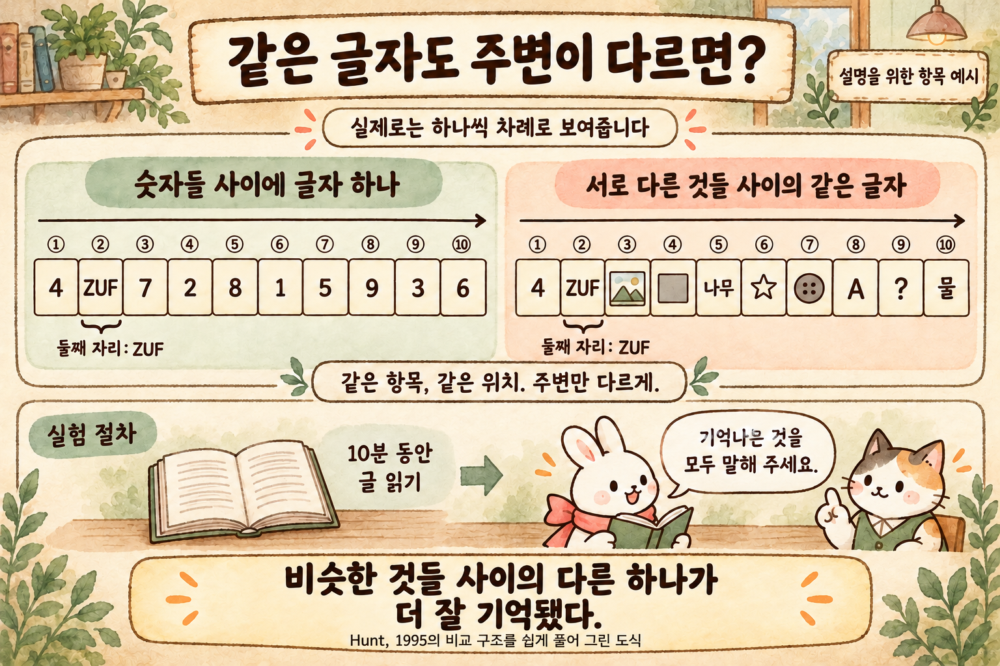
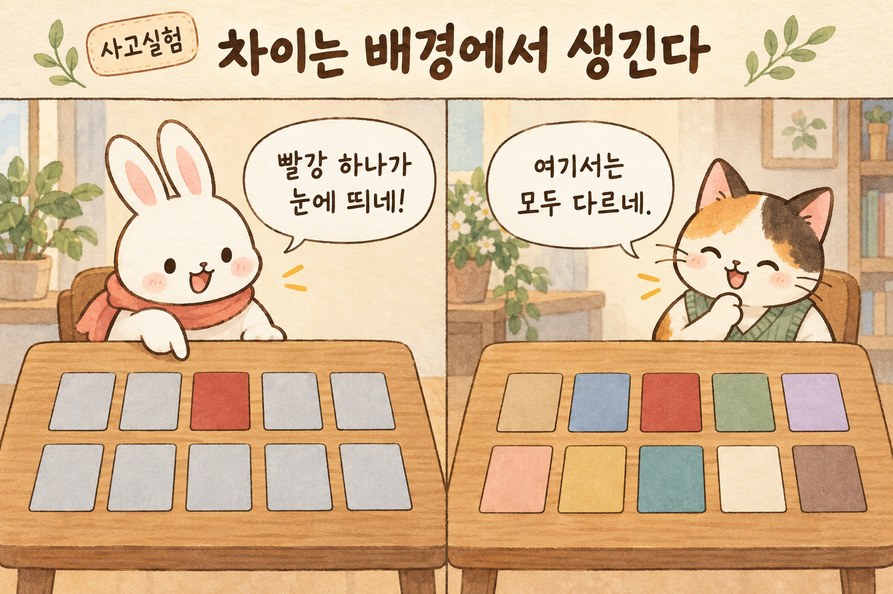
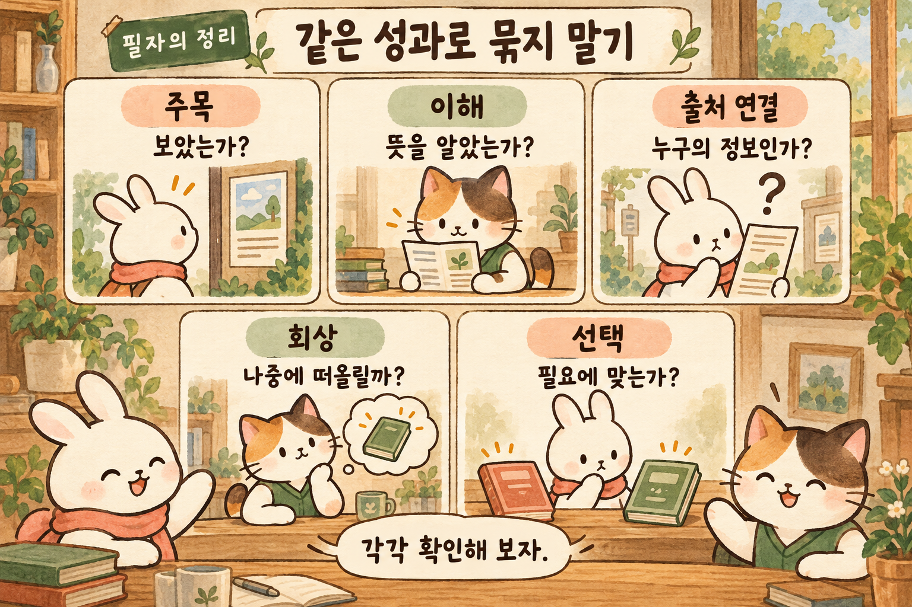
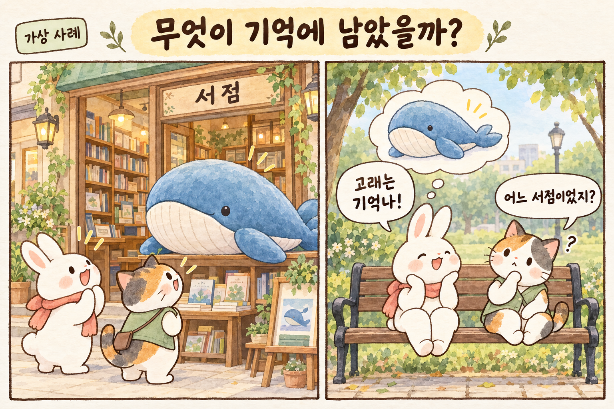
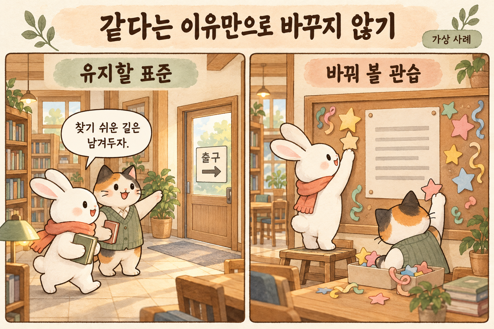
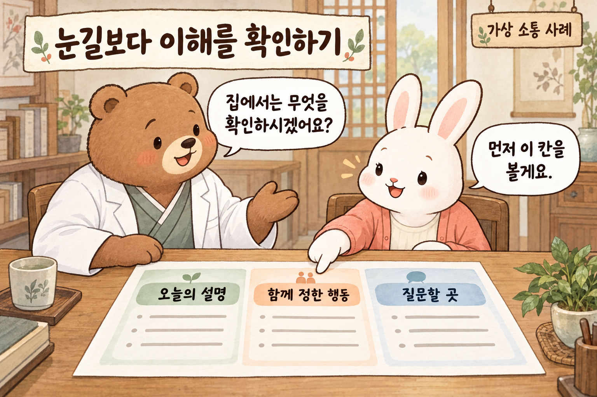
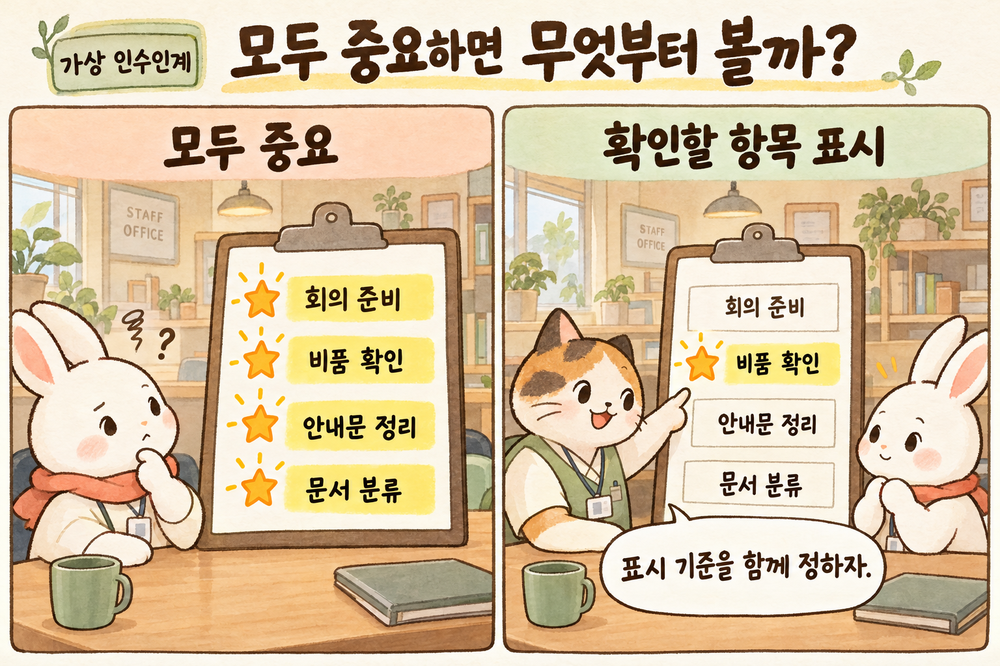

# 눈에 띄는 광고는 왜 제품 이름까지 기억시키지 못할까

《선택하는 인간》 제4편 · 2026-10-21 문체 교정

광고 장면은 기억하면서 회사나 제품은 떠올리지 못하는 경우가 있다. 주변과의 차이가 기억에 미치는 영향과, 주목·이해·상표 기억을 구별해야 하는 이유를 살펴본다.

## 들어가며 · 광고 장면과 회사 이름을 따로 기억하는 문제

눈에 띄는 광고를 기억해도 회사나 제품 이름까지 기억하는 것은 아니다. 친구들과 저녁을 먹다가 오래전 광고 이야기가 나오는 가상 장면을 생각해 보자. 누군가는 우스꽝스럽게 춤추던 등장인물을 흉내 낸다. 다른 사람은 마지막 장면까지 정확히 기억한다. 그런데 어느 회사 광고였느냐고 묻자 식탁이 조용해진다. 이 장면에서 사람들은 광고와 회사 이름을 함께 떠올리지 못했다. 광고는 우리의 기억에 들어갔지만, 회사와 제품에 관한 정보는 기억하지 못한 것이다.

우리는 흔히 잊히는 것을 두려워한다. 그래서 더 큰 글씨, 더 강한 색, 더 뜻밖의 이야기를 찾는다. 경쟁자가 모두 점잖으면 익살을 넣고, 모두 익살스러우면 진지함을 내세운다. 그러나 차별화의 성패를 눈에 띄었는지만으로 판정하면 중요한 질문이 빠진다. 무엇과 비교해서 달랐는가. 무엇이 기억되었는가. 그 기억은 필요한 순간에 무엇을 떠올리게 하는가.

Richard Shotton의 《The Choice Factory》 제4장은 차별성에서 출발한다. 이 글에서는 주변과 구별되는 정보가 기억에 미치는 영향을 설명하고, 그 결과를 실제 안내에 적용할 때의 한계를 살펴본다. 광고를 보는 것과 내용을 이해하는 것, 상표를 기억하는 것과 신뢰하는 것을 구분하려는 것이다. 이 단계들이 반드시 차례로 이어진다고 가정하지 않고, 주목을 얻은 정보가 실제 이해와 기억으로 이어졌는지 구분해 평가해야 한다.

## 01 · 주변과의 대비는 기억에 어떤 영향을 줄까

원서는 역의 인파 속에서 독특한 머리 모양을 한 직원을 발견하는 장면을 제시한다. 저자는 비슷한 항목들 사이에 다른 항목이 섞이면 그것이 더 잘 기억되는 고립 효과를 광고와 연결한다. 검은 숫자들 사이의 파란 숫자, 자동차 상표들 사이의 다른 업종 상표처럼 주변과의 대비를 바꾸어 보는 것이다. 이는 원서가 소개하는 설명이며 모든 광고의 성공을 보장하는 공식은 아니다.

같은 파란색이라도 주변이 어떤 색인지에 따라 구별되는 정도가 달라진다. 흰 종이 위에 검은 점 하나를 찍으면 그것이 보인다. 검은 점으로 종이를 채우면 빈자리 하나가 눈에 들어온다. 모두가 소리치는 방에서는 조용한 사람이, 엄숙한 식장에서는 갑작스러운 웃음이 특별해진다. 이 예들은 실험 결과를 재현한 것이 아니라 차이가 관계 속에서 생긴다는 점을 생각하기 위한 비유다.

따라서 ‘우리만의 특징은 무엇인가’라는 질문에는 비교 집합을 붙여야 한다. 같은 거리의 가게와 비교하는가, 휴대전화 화면에서 동시에 보이는 다섯 후보와 비교하는가, 고객이 과거에 겪었던 경험과 비교하는가. 제작자에게 새로운 것이 독자에게도 새롭다는 보장은 없다. 반대로 업계에서는 평범한 안내 방식이 처음 방문한 사람에게는 낯설 수 있다. 무엇이 다른지는 제작자의 판단만으로 정할 수 없고, 실제 독자가 비교하는 대상에 따라 달라진다.

## 02 · 기억 실험은 차별성의 어떤 설명을 뒷받침할까

폰 레스토르프 효과를 ‘튀는 것은 잘 외워진다’로만 외우면 정작 연구의 질문이 사라진다. Hunt는 1995년 논문에서 초기 연구를 재검토하고 대학생 지원자 40명이 참여한 재현을 보고했다. 열 항목 중 둘째 자리에 있는 숫자나 무의미 음절을, 주변 항목이 동질적인 목록과 여러 종류가 섞인 목록에서 비교했다. 목록 뒤 10분의 읽기 과제를 거친 회상에서 고립 항목의 이점이 나타났다. 이른 위치에서도 차이가 나타났다는 점은 제시 순간의 놀람만으로 효과를 설명하기 어렵게 한다. [Hunt의 논문](https://link.springer.com/content/pdf/10.3758/BF03214414.pdf)

같은 글자 ZUF를 같은 둘째 자리에 두고 주변 항목의 구성을 달리한 설명용 예시. ZUF와 그림 속 구체적 항목은 원연구 자극의 복제가 아니다. 실제 연구는 항목을 하나씩 제시했다. Hunt(1995)의 비교 구조 중 한 유형을 쉽게 풀었으며 동물은 설명용 캐릭터다. [연구 출처](https://doi.org/10.3758/BF03214414) · [원본 크게 보기 ↗](./art/memory-study-v2.png)

이 결과는 표본과 과제의 범위 안에서 해석해야 한다. 이 연구는 소규모 대학생 표본의 목록 기억을 측정했으며 일상의 선택 전체를 측정하지 않았다. 1933년 독일어 원논문을 이 글에서 직접 확인한 것은 아니며, 역사적 실험의 해석은 Hunt의 재검토에 따른다. 하나의 재현은 중요하지만 효과의 보편성이나 유일한 기전을 확정하지 않는다. 특히 기억 과제의 결과를 치료 설명의 이해도나 실제 구매율로 옮길 수는 없다. [같은 논문의 방법과 논의](https://link.springer.com/content/pdf/10.3758/BF03214414.pdf)

같은 기억 결과를 설명할 수 있는 과정도 구분해야 한다. 눈길을 더 주었기 때문에 기억했는가. 비슷한 기억끼리 뒤섞이는 가운데 혼자 구별하기 쉬웠는가. 기억을 되찾는 순간 유용한 단서가 있었는가. 이들은 서로 배타적이지 않지만 같은 설명도 아니다. ‘특별해서 기억했다’는 말은 현상을 다시 이름 붙인 것일 수 있다. 어떤 차이가 어떤 과정에 도움이 되었는지까지 물어야 원인을 구체적으로 검토할 수 있다.

## 03 · 같은 빨간 카드도 주변 색에 따라 달라 보인다

탁자 위에 회색 카드 아홉 장과 빨간 카드 한 장을 놓는다고 상상하자. 잠깐 보여주고 치운 뒤 어떤 카드가 있었는지 묻는다. 다음에는 빨강, 파랑, 노랑, 초록 등 제각각인 카드 열 장을 놓는다. 빨간 카드 자체는 바뀌지 않았다. 그런데 두 번째 탁자에서는 그것을 유일한 색으로 부를 수 없다. 이 사고실험은 특정 회상률을 예측하려는 것이 아니다. 특별함을 물건의 고정 속성으로 오해하지 않기 위한 장치다.

배경이 달라지면 같은 빨강의 차별성도 달라진다. 설명을 위한 사고실험이며 실제 연구의 회상률을 재현한 그림은 아니다. [원본 크게 보기 ↗](./art/context-cards.png)

이제 모두가 이 원리를 배우고 포장지를 빨갛게 만든 시장을 상상해 보자. 빨간색은 더 이상 주변과 구별되는 특징이 아니다. 검은 포장지 하나가 다시 특이해질 수도 있다. 경쟁자들이 행동하면 나의 특징이 달라지므로, 어제 성공한 외형을 복제하는 것만으로 내일의 성공을 확보할 수 없다. 이것은 특정 시장에서 검증한 법칙이 아니라 경쟁 상황을 해석하는 논리다. 어떤 특징이 구별되는지는 다른 제품과 표현이 바뀔 때마다 달라질 수 있다.

그렇다고 색이나 디자인을 계속 바꿔야 하는 것은 아니다. 매번 바뀌는 가게는 처음에는 흥미로워도 나중에 다시 찾기 어려울 수 있다. 이때 운영자는 두 일을 함께 해야 한다. 처음 보는 사람이 알아챌 차이를 만들고, 다시 보는 사람이 같은 곳임을 알아볼 연결을 유지하는 일이다. 앞의 일만 하면 변덕스럽고, 뒤의 일만 하면 다른 후보와 구별되지 않을 수 있다. 어느 쪽을 얼마나 바꿀지는 실제 독자의 과제에서 판단해야 한다.

## 04 · 주목·이해·상표 기억·선택을 구분해서 평가하기

처음의 식탁 장면으로 돌아가자. 광고 속 춤을 기억한 사람은 회사 이름을 떠올리지 못했다. 다른 사람은 회사 이름을 외웠지만 무엇을 파는지 잘못 안다. 또 다른 사람은 제품을 정확히 이해했어도 가격이나 필요 때문에 사지 않는다. 여기에는 적어도 주목, 내용 이해, 출처와의 연결, 필요할 때의 회상, 선택이라는 서로 다른 질문이 있다. 이 구분은 각각 무엇을 확인할지 정하기 위한 분석 틀이며 뇌 안의 단일한 순서를 입증한 모형은 아니다.

실무에서도 주목과 이해, 실제 행동을 서로 다른 지표로 평가해야 한다. 안내문 앞에서 오래 멈춘 사람이 많다는 사실만으로 안내가 좋아졌다고 말할 수 없다. 흥미로워서 멈췄을 수도, 이해하지 못해 오래 읽었을 수도 있다. 댓글이 늘어도 무엇을 기억했는지 확인해야 한다. 직원들이 회의에서 새 표어를 잘 외워도 실제 인수인계에 필요한 항목을 빠뜨리면 운영상의 목표는 달성되지 않았다. 지표가 대답하는 질문과 우리가 알고 싶은 질문을 맞추어야 한다.

평가의 시점도 달라진다. 보여준 직후 ‘마음에 드나요’라고 묻는 것과, 다음 날 필요한 정보를 찾아보게 하는 것은 다른 과제다. 제품의 이름을 알려주고 기억을 묻는 것과 아무 단서 없이 무엇이 떠오르는지 묻는 것도 다르다. 좋은 결과 하나를 모든 종류의 기억으로 넓혀 부르지 않으면, 차별성의 장점과 실패 지점이 더 구체적으로 보인다. 효과를 의심하는 일은 효과를 부정하는 일과 다르다.

주목·이해·출처 연결·회상·선택은 각각 확인할 질문이다. 필자의 분석 틀이며 뇌 안의 자동적인 인과 순서를 제시한 모형이 아니다. [원본 크게 보기 ↗](./art/separate-questions.png)

## 05 · 광고의 독창성과 익숙함을 함께 살펴야 하는 이유

Pieters, Warlop, Wedel의 2002년 연구는 광고의 독창성과 익숙함을 함께 살폈다. 출판사 초록에 따르면 소비자 119명이 두 잡지의 전면 광고 58개를 보는 동안 시선을 추적하고, 간접 기억 과제로 상표 기억을 측정했다. 연구진은 독창적인 광고가 상표에 더 많은 주의를 끌었으며, 독창적이면서 익숙한 광고에서 상표 주목이 가장 컸다고 보고했다. ‘새로워야 하니 익숙한 것을 모두 버려야 한다’는 주장과는 다른 그림이다. [연구진이 작성한 초록](https://pubsonline.informs.org/doi/10.1287/mnsc.48.6.765.192)

다만 이 글이 직접 확인한 범위는 출판사 초록이다. 실제 광고와 소비자의 차이를 모형으로 다룬 연구를, 다른 조건이 모두 같은 광고를 무작위로 만들어 비교한 인과 실험으로 소개하지 않는다. 또한 상표에 대한 시선과 기억은 구매나 장기 신뢰의 측정값이 아니다. ‘익숙함과 새로움을 함께 살펴볼 근거가 있다’는 수준에서 받아들이고, 어떤 조합이 어느 독자에게 통하는지는 별도로 확인해야 한다. [출판사 연구 개요](https://pubsonline.informs.org/doi/10.1287/mnsc.48.6.765.192)

생활 속 안내에서도 익숙한 절차를 유지하면서 필요한 정보를 두드러지게 제시하는 방안을 생각해 볼 수 있다. 처음 가는 도서관에서 대출 절차는 익숙하게 유지하되, 오늘 반납할 책을 찾는 표시는 분명하게 만들 수 있다. 음식점은 메뉴를 읽는 방법까지 새로 발명하지 않고도 조리 원칙을 구체적으로 설명할 수 있다. 이것들은 논문이 직접 시험한 처방이 아니라 연구에서 출발한 설계 제안이다. 새롭게 바꿀 요소와 이용자의 이해를 위해 유지할 요소를 함께 검토해야 한다.

## 06 · 인상적인 광고 장면을 서비스 이름과 연결하기

원서는 보험 비교 서비스의 미어캣 광고를 업종 관습을 벗어난 사례로 소개한다. 이 사례에서 흥미로운 것은 단지 동물이 귀엽다는 점이 아니다. 보험 비교를 설명하는 전형적인 장면에서 벗어나면서도, 말장난을 통해 광고 장면을 서비스 이름과 연결했다는 점이다. 다만 여기서 그 캠페인의 성과를 독립적으로 검증하거나 매출 증가의 원인을 확정한 것은 아니다. 원서의 사례와 인과 증거를 구별할 필요가 있다.

가상의 동네 서점을 생각해 보자. 계산대 옆에 커다란 고래 인형을 둔다. 손님은 사진을 찍지만 책방 이름을 모를 수 있다. 반면 ‘오늘 산 책에서 오래 남은 한 문장을 다음 방문 때 들려주세요’라는 작은 카드가 있다면, 그 카드는 독서 경험과 다시 방문할 이유를 연결할 수 있다. 후자가 반드시 더 잘 팔린다는 뜻은 아니다. 무엇을 기억하게 하려는지에 따라 같은 장식도 서로 다른 역할을 한다는 이야기다.

고래 인형은 떠올라도 어느 서점인지는 기억나지 않을 수 있다. 가상 사례이며 실제 광고 성과를 보고한 장면은 아니다. [원본 크게 보기 ↗](./art/memory-bookshop.png)

광고의 독특한 장면이 제품이나 서비스의 설명에 실제로 도움이 되는지도 확인해야 한다. 인형을 빼도 서비스의 장점이 설명되는가. 독특한 이름을 지워도 고객이 얻을 것이 명료한가. 반대로 재미있는 장면만 남겼을 때도 어디서 무엇을 해야 하는지 알 수 있는가. 이런 질문은 창작을 밋밋하게 만들기 위한 검열이 아니다. 기억에 남은 장면을 통해 필요한 정보도 떠올릴 수 있는지 확인하는 과정이다.

## 07 · 조직이 기존 방식을 유지하는 이유를 구분하기

원서는 조직이 차별성을 피하는 이유로 실패에 대한 책임 문제를 제시한다. 남들이 하던 방식을 따르면 실패해도 설명하기 쉽고, 전례 없는 방식을 택하면 선택한 사람이 더 많은 설명을 요구받는다는 것이다. 이는 조직을 바라보는 저자의 해석으로 읽어야 한다. 모든 직원의 동기를 측정해 입증한 결과처럼 확대해서는 안 된다. 다만 회의에서 ‘경쟁사도 합니까’라는 질문이 왜 힘을 얻는지 생각하게 한다.

이를 더 넓혀 보면, 비슷한 모양에는 서로 다른 이유가 있을 수 있다. 책임을 피하려고 따라 했을 수도 있지만 이용자가 이미 익힌 방식이 편해서 유지했을 수도 있다. 절차의 호환성이나 오류 방지를 위해 통일했을 수도 있다. 안내문의 항목 순서를 바꾸지 않았다는 이유만으로 조직이 창의성을 억압한다고 결론 내리면, 유용한 표준과 무의미한 관습을 함께 버리게 된다.

이용자가 길을 찾도록 돕는 익숙한 표준과 바꿔 볼 장식을 구별하는 가상 사례. 실제 안전표지 규격이나 검증된 행동 효과를 제시한 도해가 아니다. [원본 크게 보기 ↗](./art/standards-customs.png)

그러므로 좋은 회의는 ‘왜 남들과 같습니까’에서 멈추지 않는다. 같은 방식을 유지하면 누가 어떤 업무를 더 쉽게 수행하는지 묻는다. 낯선 방문자의 이해를 돕는 표준은 유지할 가치가 있다. 아무도 이유를 설명하지 못하는 수식어는 바꾸어 볼 수 있다. 실험이 필요하다면 실패를 허용할 범위와 확인할 결과를 먼저 정한다. 새로운 시도를 제안한 사람에게만 사후 책임을 몰아주는 조직에서는 직원들이 제안의 책임을 피하려고 기존 방식을 택할 수 있다.

## 08 · 독특한 표현보다 익숙한 안내가 필요한 경우

가장 강한 반론은 이렇다. 인간의 관심은 유한한데 모두가 자신의 메시지를 특별하게 만들면 세상은 더 피곤해지는 것 아닌가. 독자는 필요한 정보를 찾으러 왔지, 모든 기관의 창의적인 인사말을 감상하러 온 것이 아니다. 출구를 알려주는 표시나 신청 취소 방법은 작품처럼 해독하게 만들 이유가 없다. 전달자가 기억되고 싶다는 욕구와 이용자가 빨리 일을 마치고 싶다는 욕구는 충돌할 수 있다.

또한 사람마다 배경이 다르다. 한 독자에게 익숙한 기호가 다른 독자에게는 수수께끼일 수 있다. 작은 글자를 읽기 어렵거나 색 차이를 구별하기 어려운 사람에게 색상 하나로만 중요한 내용을 전달한다면, 그 정보를 알아보지 못할 수 있다. 이 글에서는 특정 연령 집단의 기억 능력을 단정하지 않는다. 실제 이용자에게 읽고 찾고 설명해 보도록 하는 편이 나이만으로 이해도를 추정하는 것보다 직접적인 확인이다.

이 반론을 받아들이면 차별성의 목표도 달라진다. 화면 전체가 특별할 필요는 없다. 사용자가 지금 찾아야 하는 부분이 다른 정보와 구별되면 된다. 취소와 동의 버튼의 뜻은 분명해야 하고, 불리한 조건을 흐린 글씨로 숨겨서는 안 된다. 차별성의 윤리적 질문은 ‘내가 얼마나 주목받았는가’보다 ‘상대가 알아야 할 것을 놓치지 않았는가’에 가까워진다.

## 09 · 환자 안내문에서 무엇을 먼저 확인하게 할까

다음은 실제 임상 연구가 아닌 가상의 한의원 장면이다. 진료를 마친 환자가 생활 안내문을 받는다. 치료 설명, 비용, 다음 방문 일정, 집에서 확인할 내용이 모두 같은 크기로 빽빽하다. 환자는 고개를 끄덕였지만 집에서는 어느 부분부터 다시 읽어야 할지 모른다. 안내문에 귀여운 그림을 더하는 것만으로 이 문제가 해결되지는 않는다. 먼저 이번 상담에서 환자와 확인한 핵심이 무엇인지 정해야 한다.

설계안은 단순할 수 있다. 첫 칸에는 환자가 이해한 오늘의 설명을, 둘째 칸에는 함께 정한 다음 행동을, 마지막 칸에는 질문이 생겼을 때 연락할 경로를 둔다. 특히 확인이 필요한 내용은 색뿐 아니라 제목, 여백, 구체적인 문장으로도 구별한다. 실제 의학적 안내 내용은 환자 상태와 진료 판단에 맞게 작성해야 한다. 이 형식 자체가 치료 결과를 개선한다고 입증된 것처럼 말하지 않는다.

함께 정리한 안내문에서 무엇을 확인할지 묻는 가상 소통 사례. 이 형식이 치료 효과를 개선한다는 증거를 제시한 그림은 아니다. [원본 크게 보기 ↗](./art/clinic-understanding.png)

차별성을 판단하는 순간도 달라진다. ‘예쁜가요’보다 ‘집에 가서 무엇을 먼저 확인하시겠어요’라고 묻는다. 환자가 다른 부분을 짚으면 읽는 사람의 관점에서 우선순위를 다시 살핀다. 치료를 선택하지 않을 권리와 대안, 부담을 설명하는 문장도 찾기 쉬워야 한다. 유리한 정보만 크게 만들고 불확실성은 작게 쓰는 안내는 눈에 잘 들어올 수 있어도 충분한 이해를 돕는 안내라고 부르기 어렵다.

## 10 · 인수인계에서 변경 사항과 미완료 업무를 구별하기

직원 교육에서도 가상의 두 상황을 비교해 보자. 첫 조직은 매주 다른 구호를 벽에 붙인다. 둘째 조직은 익숙한 인수인계 양식에서 오늘 바뀐 예약과 확인이 끝나지 않은 업무를 일정한 위치에 표시한다. 어느 쪽이 더 좋은지는 실제 결과를 보아야 한다. 그러나 운영자가 원하는 것이 문구의 암기인지 업무 누락의 감소인지 먼저 구분하면 시험해 볼 설계가 명료해진다.

여기서도 예외를 강조하는 장치가 새 부담을 만들 수 있다. 모든 업무에 중요 표시를 붙이면 우선순위를 읽기 어렵다. 담당자마다 다른 방식으로 강조하면 교대 때 해석 비용이 생긴다. 중요함의 기준과 표시를 지우는 시점을 함께 정할 필요가 있다. 이 제안은 고립 효과 하나에서 곧바로 도출되는 실증 결론이 아니라, 정보를 구별할 수 있게 만들려는 운영 원칙이다.

모의 인수인계 양식에서 강조의 기준을 함께 정하는 가상 사례. 한 항목만 표시한 양식이 업무 오류를 줄였다고 측정한 연구 결과는 아니다. [원본 크게 보기 ↗](./art/handover-priorities.png)

점검은 필요한 정보를 실제로 찾을 수 있는지 확인하는 것부터 시작할 수 있다. 민감한 환자 정보를 쓰지 않은 모의 업무로 새 직원이 필요한 항목을 찾아 설명하게 할 수 있다. 어디서 멈추었는지, 무엇을 잘못 이해했는지 적고 양식을 고친다. 실제 운영 변화를 비교한다면 업무량이나 직원 구성의 차이도 함께 기록해야 한다. 한 주의 실수가 줄었다는 이유만으로 새 색상의 효과라고 단정하지 않는 태도까지가 차별성 설계의 일부다.

## 나가며 · 독자가 필요한 정보를 기억하고 다시 찾는가

제작자는 표현이 독특한지 살피고, 독자는 자신에게 필요한 정보를 찾는다. 독특한 표현이 필요한 정보를 찾고 기억하는 데 도움이 되는지 확인해야 한다. 눈에 잘 띄는 표지가 길을 알려주고, 기억하기 쉬운 표현이 중요한 설명으로 되돌아가게 한다. 표현과 정보가 연결되지 않으면 재치 있는 광고의 등장인물만 남거나, 기관 이름만 남고 정작 알아야 할 조건은 사라질 수 있다.

어떤 내용을 더 크게 만들기 전에 평범한 질문을 하나 해보자. 독자가 이 장면 하나만 기억한다면 무엇을 알게 되는가. 다음 날 그것을 떠올렸을 때 필요한 정보나 행동으로 돌아올 수 있는가. 그리고 그 기억은 스스로 판단할 재료를 주는가. 이 질문에는 모든 상황을 해결하는 색깔이나 글꼴이 없다. 대신 실제 독자에게 확인할 수 있는 과제가 있다.

남과 다르게 보이는 일은 출발점이 될 수 있다. 그 다음에는 무엇을 구별하고 무엇을 연결할지 결정해야 한다. 익숙한 안내 방식은 유지하고, 지금 확인해야 할 정보는 구별하기 쉽게 제시해야 한다. 독자가 무엇을 이해하고 기억했는지, 필요할 때 다시 찾을 수 있는지까지 확인하는 것이 차별성을 활용하는 기준이다.

## 출처와 확인 범위

- **A · 원서 직접 확인:** Richard Shotton, *The Choice Factory*, 제4장 Distinctiveness. 사용자 제공 EPUB의 해당 장을 직접 읽었다. 원서의 자체 실험 배수와 기업 성과 수치는 독립 검증이 없어 본문에 사용하지 않았다.
- **B · 직접 확인한 연구:** R. Reed Hunt (1995), “The subtlety of distinctiveness: What von Restorff really did.” *Psychonomic Bulletin & Review*, 2, 105–112. [논문](https://doi.org/10.3758/BF03214414). 논문 자체의 40명 재현 방법과 결과를 확인했다. 1933년 원논문 직접 열람으로 표시하지 않는다.
- **C · 후속 재검토:** 위 Hunt 논문의 역사적·이론적 재검토를 사용했다. 대규모 메타분석이나 최신 연구 전체의 체계적 검토를 수행한 것은 아니다.
- **B · 초록 확인:** Rik Pieters, Luk Warlop, Michel Wedel (2002), “Breaking Through the Clutter: Benefits of Advertisement Originality and Familiarity for Brand Attention and Memory.” *Management Science*, 48(6), 765–781. [출판사 초록](https://doi.org/10.1287/mnsc.48.6.765.192). 전문 접근은 확보하지 못했으며 표본·과제·결론은 초록에 명시된 범위로 제한했다.
- **D · 독자적 확장:** 식탁·카드·서점·도서관·한의원·직원 교육 장면, 단계 구분, 운영 및 윤리 제안은 필자의 사고실험과 해석이다. 임상 효과나 실제 기관의 성과를 보고한 사례가 아니다.
