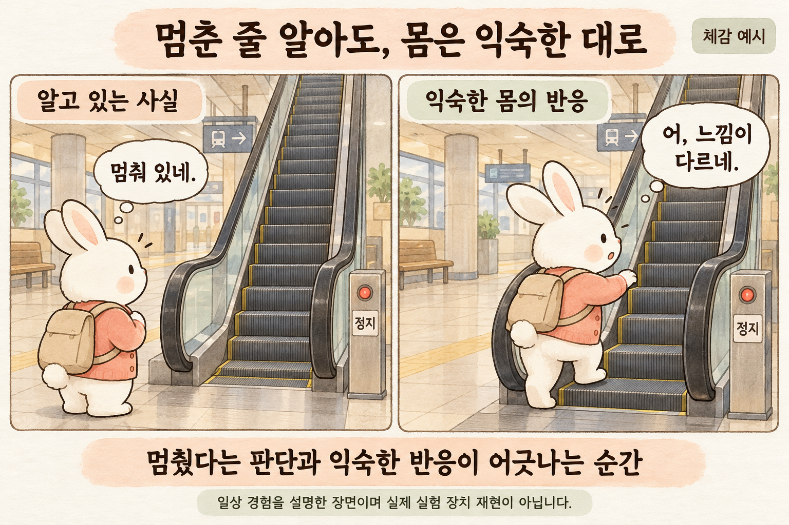
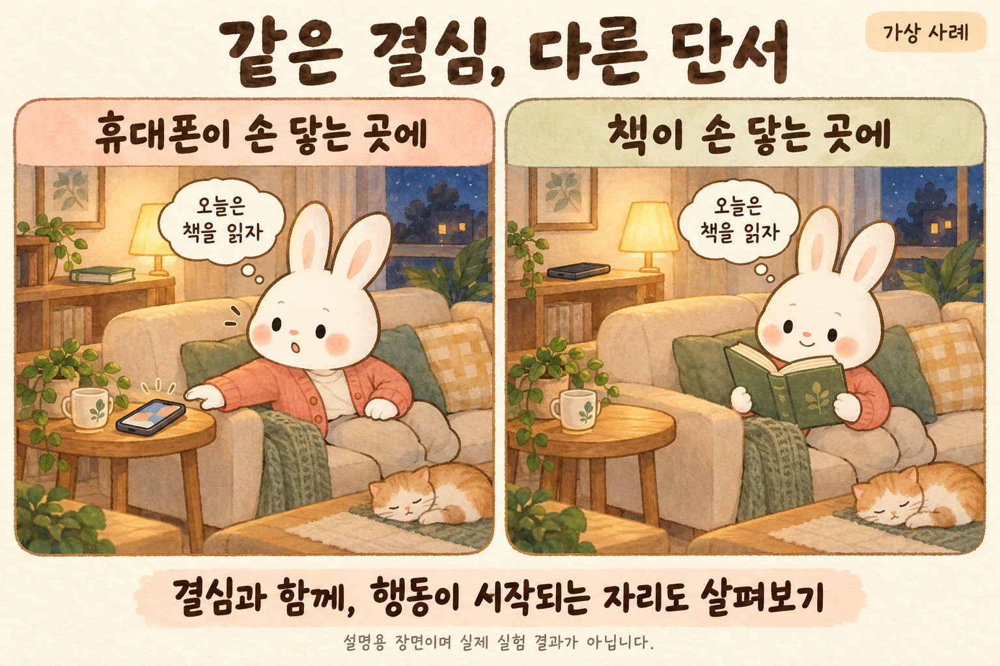
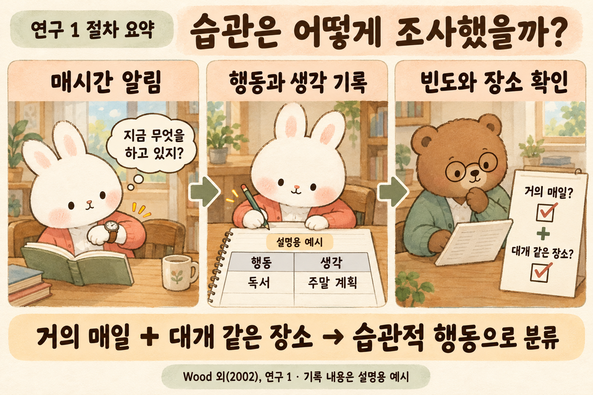
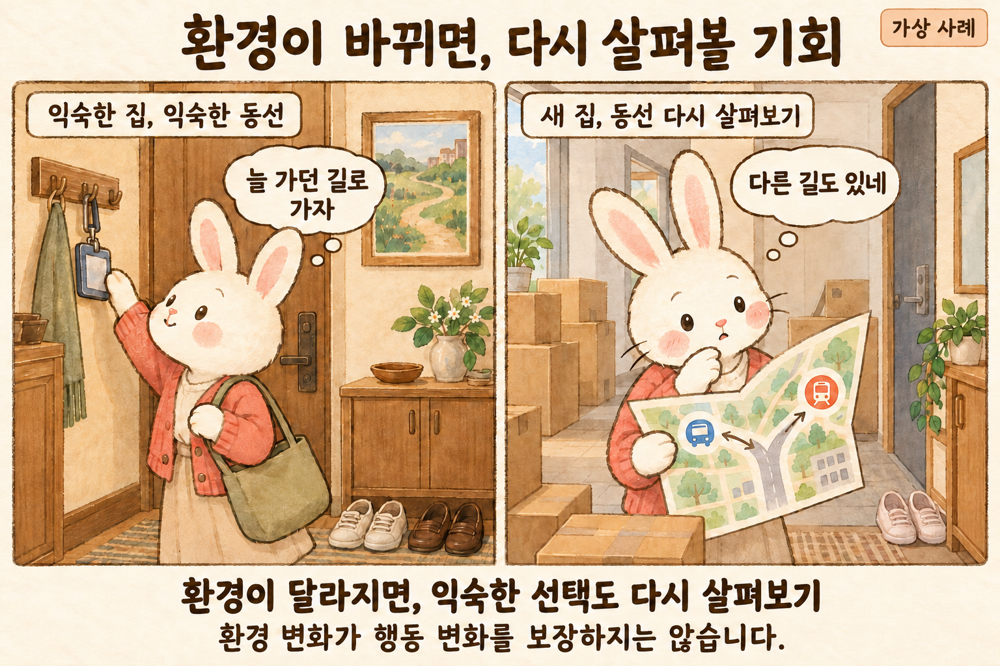
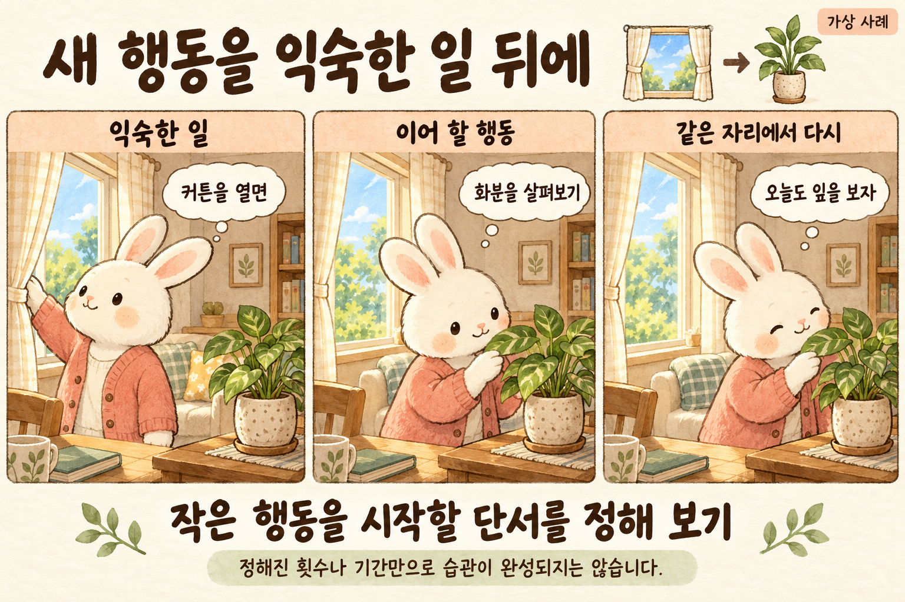
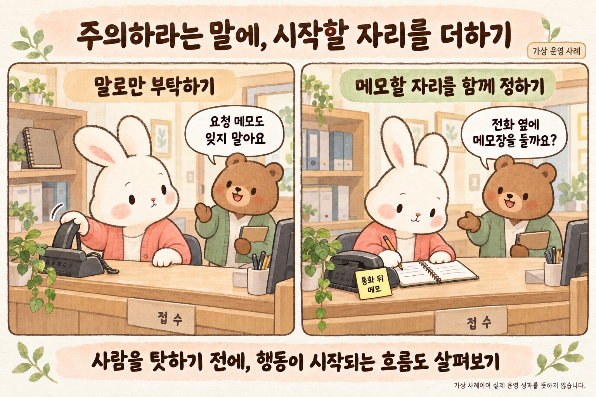

# 제5편 · 삽화 문단 배치

승인 원본 6종을 실제 앞뒤 문단에 연결했다. 05-02 V3, 05-06 V1을 선택했다. 개념 05-01과 실천 05-03은 별도 절에 두어 역할을 구별했다.

## 05-06 · 멈춘 줄 알아도, 몸은 익숙한 대로

- 앞 문단: `para-opening-2`
- 뒤 문단: `para-opening-3`

> 이 장면과 관련해 레이놀즈와 브론스타인이 연구한 것은 실제 에스컬레이터가 아니라 실험용 이동 발판이었다. 출판사 초록에 따르면, 참가자들은 정지한 발판과 움직이는 발판에 올라서는 과정을 거친 뒤, 다시 멈춘다는 명확한 안내를 받았다. 그래도 처음에는 이전 움직임에 적응한 반응이 잠깐 남았다. 운동 적응 연구의 결과이며, 구매 습관까지 같은 기제로 설명했다는 뜻은 아니다. [B1]

일상의 체감을 설명하는 장면입니다. 실제 연구의 이동 발판 장치를 재현한 그림이 아니며 모든 사람의 반응을 뜻하지 않습니다.

> 이 구별을 유지하면서, 행동을 바꾸겠다는 의도만으로 이전 행동이 멈추지 않는 이유를 살펴보려 한다. 저녁에는 책을 읽겠다고 정한 사람이 소파에 앉자마자 휴대전화를 집는 장면을 떠올려 보자. 결심을 거짓말로 판정하기 전에 휴대전화를 집기 직전의 행동과 주변 조건을 확인할 수 있다.

## 05-01 · 같은 결심, 다른 단서

- 앞 문단: `para-cues-1`
- 뒤 문단: `para-cues-2`

> 가상의 두 거실이 있다. 두 사람 모두 잠들기 전에 책을 읽으려 한다. 한쪽에서는 휴대전화가 앉은 자리 바로 옆에 있고 책은 뒤편 가구 위에 있다. 다른 쪽에서는 읽던 책을 손에 들고 휴대전화는 떨어진 가구 위에 놓여 있다. 사람의 성격을 같게 만들 수는 없지만, 행동을 시작하는 데 필요한 동작이 서로 다르다는 점은 눈으로 확인할 수 있다.

같은 결심과 다른 시작 조건을 비교한 가상 장면입니다. 물건 배치의 효과를 검증한 실험 결과가 아닙니다.

> 이 그림은 물건을 옮겼더니 독서량이 늘었다는 실험 보고가 아니다. ‘책 읽기’를 시작하기 위해 필요한 구체적인 동작을 나누어 보는 사고실험이다. 앉는다, 손을 뻗는다, 화면을 켠다. 혹은 책을 집고, 표시한 쪽을 연다. ‘책 읽기’라는 목표는 같아도 실제로 책을 집기 위해 필요한 준비와 동작은 다를 수 있다.

## 05-05 · 습관은 어떻게 조사했을까?

- 앞 문단: `para-diary-1`
- 뒤 문단: `para-diary-2`

> 우드·퀸·캐시의 2002년 논문에는 두 일지 연구가 있다. 연구 1의 분석 대상 대학생 70명은 하루 동안, 연구 2의 209명은 이틀 동안 깨어 있는 시간에 매시 기록했다. 시계 신호에 맞춰 행동·생각·감정을 적고, 후속 질문으로 평소 빈도와 장소 등을 확인했다. 연구 1은 한 행동을, 연구 2는 동시에 하는 여러 행동도 기록할 수 있었다. [B2]

Wood 외(2002) 연구 1의 방법을 설명한 도해입니다. 동물 인물과 일지 행은 창작 예시이며 실제 응답이나 결과 비율이 아닙니다.

> 연구에서는 ‘거의 매일’ 하면서 ‘대개 같은 장소’에서 하는 행동을 습관적으로 분류했다. 그림의 독서와 주말 계획은 기록 방식을 보여주는 가상 예시이며 실제 참가자의 응답이 아니다. 행동과 생각을 나란히 적는 것은, 몸이 하는 일과 머릿속에 떠오르는 일이 얼마나 겹치는지 살펴보기 위한 방법이었다. [B2]

## 05-02 · 환경이 바뀌면, 다시 살펴볼 기회

- 앞 문단: `para-transition-1`
- 뒤 문단: `para-transition-2`

> 원서는 이사나 직장 변경처럼 생활의 조건이 달라지는 시점을 변화의 기회로 다룬다. 저자 측 설문도 소개하지만, 그 수치만으로 인생 사건이 브랜드 변경을 일으켰다고 단정할 수는 없다. 여기서는 원서의 관점을 소개하는 데 그친다. 2016년 종설 역시 맥락의 변화와 기존 단서의 변화가 행동을 다시 선택할 여지를 줄 수 있다고 정리한다. [A·C]

환경 변화 뒤 선택을 다시 살펴보는 가상 예시입니다. 이사나 환경 변화가 행동 변화를 보장하지 않습니다.

> 새집에서 출근하는 가상의 사람은 버스 정류장과 지하철 입구를 다시 확인한다. 예전에는 묻지 않던 질문이 생긴다. 어느 길이 덜 붐비는가, 돌아오는 시간에도 가능한가, 비가 오면 어디로 걷는가. 그림은 바뀐 조건에서 출근 방법을 다시 비교하는 과정을 보여준다. 이사를 하면 더 좋은 선택을 하게 된다거나 모든 기존 습관이 사라진다는 결과를 보여주지는 않는다.

## 05-03 · 새 행동을 익숙한 일 뒤에

- 앞 문단: `para-practice-1`
- 뒤 문단: `para-practice-2`

> 이번에는 커튼을 연 뒤 화분을 살펴보는 가상의 장면이다. ‘식물을 잘 돌보자’는 넓은 목표를 ‘커튼을 열면 잎과 흙의 상태를 본다’는 시작 동작으로 바꾸어 본다. 그림 속 인물은 매번 물을 주지 않는다. 확인 뒤에 필요한 행동은 식물의 상태에 따라 달라져야 하기 때문이다. 반복할 것은 무조건 같은 처치가 아니라 살펴보는 출발점이다.

반복할 시작 동작을 정해 보는 가상 예시입니다. 매번 물 주기를 뜻하지 않으며 정해진 횟수나 기간의 습관 완성을 보장하지 않습니다.

> 이 예시는 습관 형성의 효과를 측정한 실험이 아니라, 종설이 다루는 안정된 맥락에서의 반복을 생활 속에서 생각해 본 것이다. 그 종설은 바람직한 행동의 반복을 돕는 접근을 검토하면서도 형성을 단순한 횟수 하나로 설명하지 않는다. ‘몇 번 하면 완성’이라는 약속 대신, 정한 단서가 있을 때 실제로 그 행동을 시작했는지 확인할 수 있다. [C·D]

## 05-04 · 주의하라는 말에, 시작할 자리를 더하기

- 앞 문단: `para-workflow-2`
- 뒤 문단: `para-workflow-3`

> 전화 옆에 업무용 메모 수단을 두고 ‘통화 뒤 필요한 전달 사항 확인’이라는 시작점을 정해 보는 방안을 생각할 수 있다. 그림의 선과 항목은 내용을 비운 설명용 표기다. 실제로 적용한다면 개인정보가 타인에게 보이지 않도록 기관의 보관·접근 절차에 맞는 수단을 골라야 한다. 눈에 잘 보이는 배치가 정보 노출로 이어져서는 안 된다.

가상 업무 개선 예시입니다. 실제 환자 기록이나 검증된 운영 성과가 아닙니다. 적용 시 정보 보호와 기존 업무 절차를 함께 검토합니다.

> 배치만 바꾸고 성공했다고 선언할 수는 없다. 사용하는 사람이 기록할 틈이 있는지, 전달 대상이 분명한지, 급한 업무와 충돌하는지 확인해야 한다. 메모 수가 늘었더라도 전달이 더 정확해졌는지는 별개의 질문이다. 작은 범위에서 사용해 보고 누락과 중복, 불편을 함께 살피는 운영 제안이며 이 그림으로 효과가 검증됐다는 뜻은 아니다.

