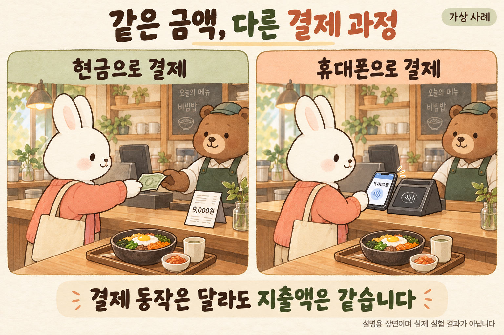
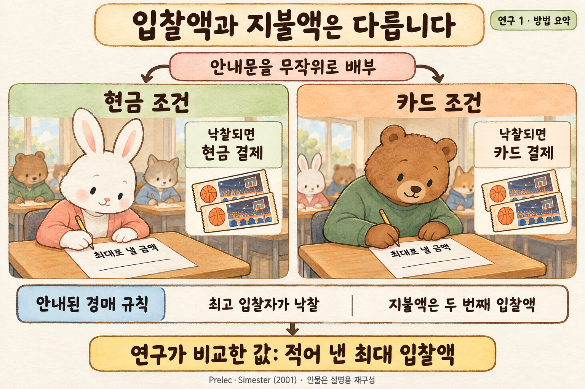
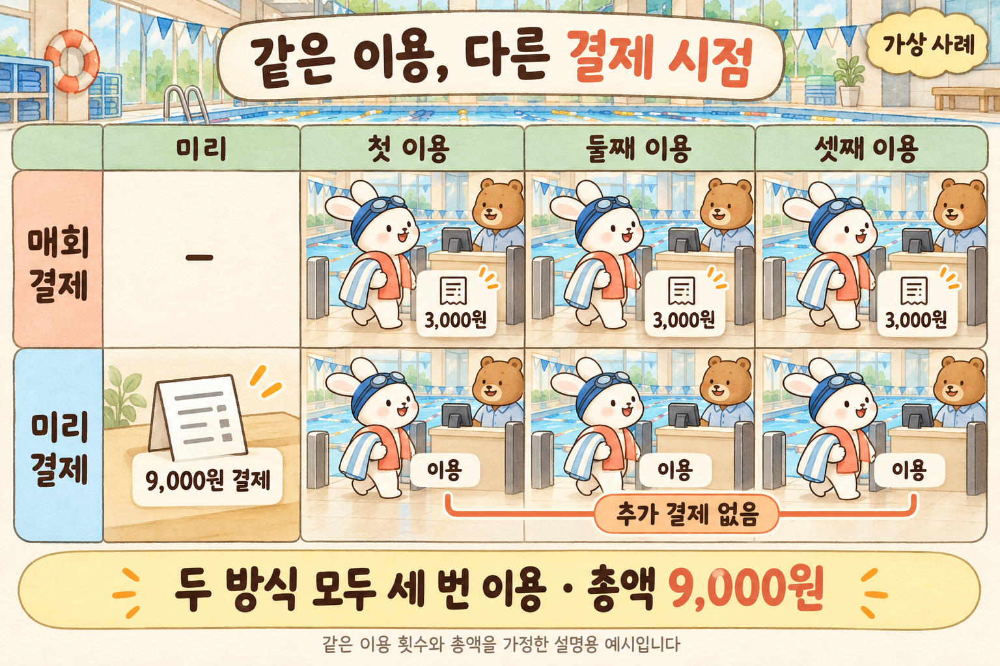
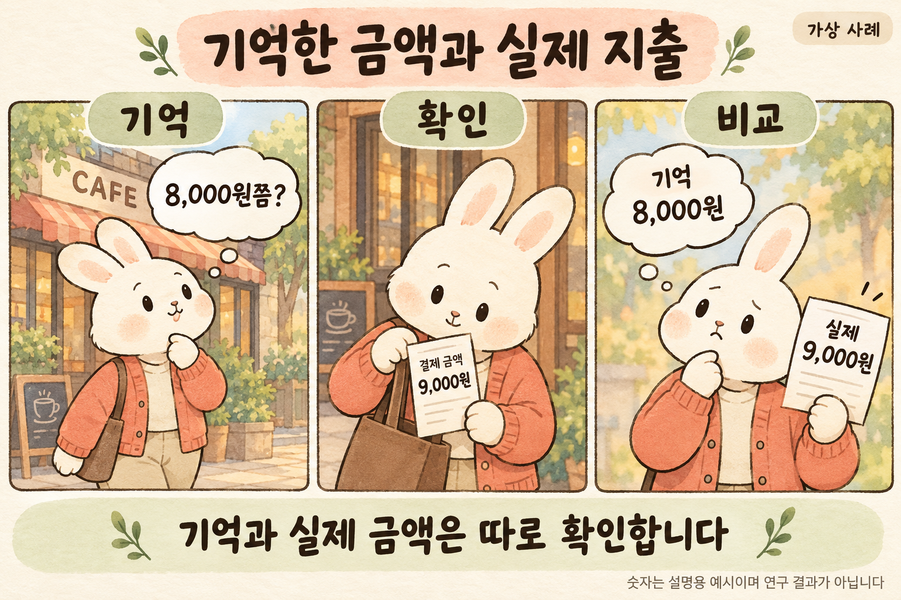
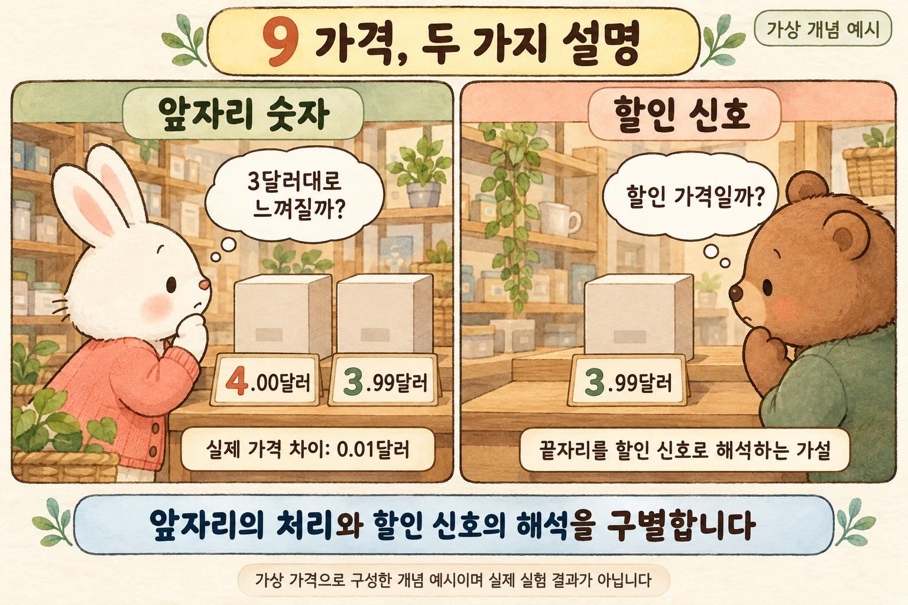
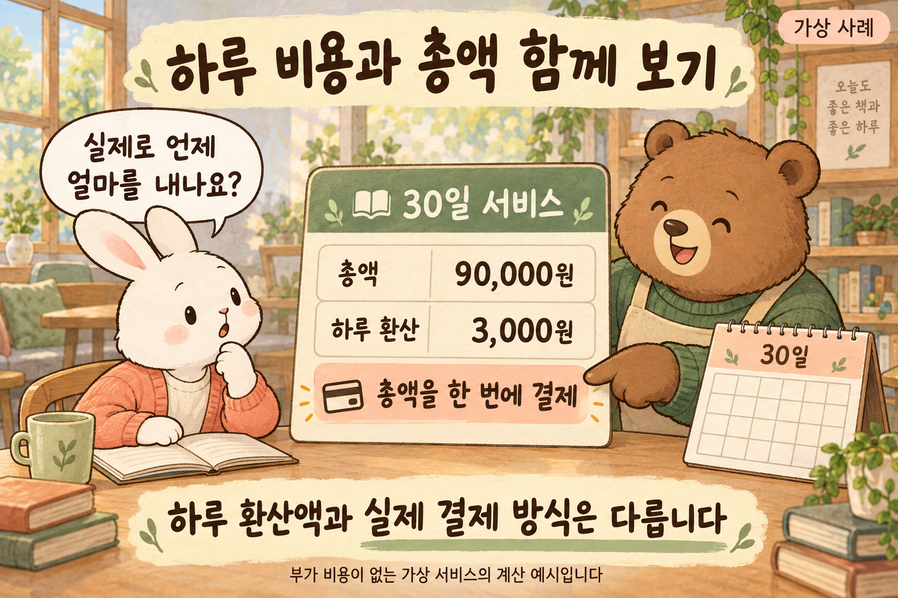
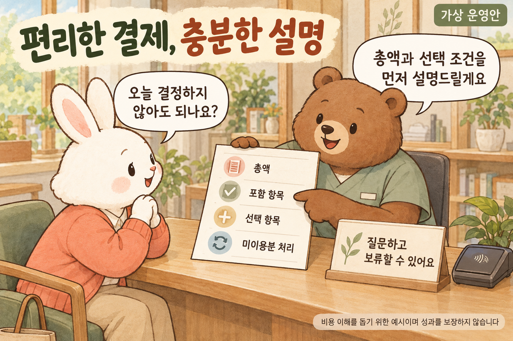

# 결제 방식은 같은 지출을 어떻게 다르게 느끼게 할까

《선택하는 인간》 제6편 · 원서 제6장 The Pain of Payment에서 출발한 확장 읽기

같은 금액을 내더라도 현금을 건넬 때와 카드를 댈 때의 느낌은 다를 수 있다. 무엇이 달라지는 걸까? 결제 과정에서 비용을 알아차리는 방식과, 가격을 보고 가치를 판단하는 과정을 구별해 살펴본다.

## 들어가며 · 결제는 끝났는데 지출한 느낌은 옅다

다음은 가상의 점심시간이다. 식사를 마친 사람이 계산대에서 휴대전화를 대고 나온다. 동료가 얼마를 썼느냐고 묻자 메뉴 가격은 떠오르지만 함께 주문한 음료가 얼마였는지는 선뜻 생각나지 않는다. 다른 날에는 지폐를 내고 거스름돈을 챙기면서 점심값을 계산한다. 같은 사람이 비슷한 식사를 했어도 결제 과정에서 금액을 확인한 동작은 달랐다. 이 장면만으로 어느 날 더 많이 썼는지는 알 수 없다. 다만 지출을 알아차릴 기회가 어떻게 달라지는지는 물을 수 있다.

동일 금액의 결제 동작을 비교한 가상 장면입니다. 지출이나 부담의 차이를 입증한 실험 결과가 아닙니다.

리처드 쇼튼은 《The Choice Factory》 제6장에서 이러한 문제를 ‘지불의 고통’이라는 이름으로 다룬다. 여기서 고통은 돈을 낼 때 반드시 심한 괴로움을 겪는다는 뜻이 아니다. 원하는 것을 얻으면서도 그 대가로 돈을 포기한다는 아쉬움, 다른 곳에 쓸 수 있었던 금액을 떠올릴 때의 부담을 가리키는 설명이다. 원서의 핵심 가설은 결제 방식이 그 부담을 얼마나 뚜렷하게 느끼게 하는지에 영향을 줄 수 있다는 것이다. [A]

결제가 편리해졌다고 실제 가격이 내려가지는 않는다. 반대로 현금을 내며 부담을 느꼈다고 더 합리적으로 골랐다는 보장도 없다. 우리는 상품의 가치, 지출을 감당할 능력, 돈이 나간다는 느낌을 구별해야 한다. 비용을 판단할 때 무엇을 보고, 어떤 정보를 놓칠 수 있는지를 살펴보려 한다.

## 1 · 물건을 얻는 기쁨과 돈을 내는 부담을 함께 생각하기

마음에 드는 물건이 있어도 가격표를 보고 구입을 미룰 수 있다. 이때 물건을 원한다는 사실과 돈을 쓰기 아깝다는 사실은 모순되지 않는다. 구매는 얻을 것과 포기할 것을 함께 판단하는 선택이다. 지불의 고통이라는 개념은 이 가운데 비용을 포기하는 경험에 주목한다. 쇼튼은 현금을 손에서 건네는 상황과 카드로 처리하는 상황에서 비용이 다르게 두드러질 수 있다고 설명한다. [A]

그러나 비용이 두드러지는 정도와 비용의 크기는 다르다. 통장에서 빠져나가는 금액을 또렷이 보면서도 꼭 필요한 물건이라면 살 수 있다. 반대로 결제 과정은 간단해도 이번 달 남은 생활비를 알고 있다면 구매를 포기할 수 있다. 결제 장면의 느낌은 판단에 들어오는 정보의 일부다. 소득과 예산, 필요, 대체 상품을 밀어내고 혼자 선택을 결정하는 힘으로 설명해서는 곤란하다.

이를 구별하기 위한 사고실험을 해 보자. 두 사람이 같은 물건을 같은 금액에 산다. 한 사람은 금액을 확인하지 않은 채 결제를 마치고, 다른 사람은 결제 전에 남은 예산을 확인한다. 두 번째 사람이 느끼는 부담이 더 크더라도 실제 손실이 더 큰 것은 아니다. 차이는 비용을 다른 지출과 연결해 생각했는지에 있다. 이 예시는 실험 결과가 아니라, 무엇을 측정해야 하는지 분명히 하기 위한 비교다.

## 2 · 카드로 입찰할 때 더 높은 금액을 제시했다는 연구

프렐렉과 시메스터의 연구 1에서는 MBA 학생들에게 무작위로 다른 안내문을 나누어 주었다. 한쪽은 낙찰되면 현금으로, 다른 쪽은 신용카드로 내도록 안내했다. 참가자는 물품에 최대로 낼 금액을 종이에 적었고, 농구 입장권에서는 카드 조건의 평균 입찰액이 더 높았다. 결제 조건을 바꾸면서 입찰 의향을 비교한 결과다. [B1]

Prelec·Simester(2001) 연구 1의 일부 방법 요약입니다. 인물은 설명용이며 안내된 규칙과 실제 정산을 구별합니다. [B1]

안내된 경매 규칙도 중요하다. 가장 높은 금액을 적은 사람이 낙찰받되 지불액은 두 번째로 높은 입찰액이었다. 따라서 연구에서 비교한 최대 입찰액과 지불액은 같지 않다. 논문은 정산에 액면가 상한과 수표 허용을 적용할 계획도 밝혀, 안내 조건과 실제 정산을 구별해야 한다. 그림은 참가자에게 안내한 규칙과 측정값을 요약한다. [B1]

여기서 입찰액을 실제 일상 지출로 바꾸어 읽어서는 안 된다. 입찰에서 제시한 최대 금액과 매장에서 지불한 금액은 다르다. 구매 빈도나 한 달 총지출도 별개의 지표다. 카드 조건에서 입찰액이 높았다는 소개를 읽었다고 해서, 모든 사람이 카드로 결제할 때 언제나 더 많이 쓴다거나 그 차이가 모든 상품에서 같다고 결론 내릴 수는 없다.

## 3 · 결제의 고통 외에 무엇이 달랐을 수 있을까

가장 먼저 떠올릴 대안은 사용할 수 있는 돈의 차이다. 가진 현금은 적지만 카드로는 더 높은 금액을 낼 수 있다면, 입찰액 차이는 지불 가능 범위가 달라서 생겼을 수 있다. 연구의 현금 조건에는 인근 현금인출기 이용 가능성을 묻는 문항도 있었다. 그러나 그 문항만으로 모든 현금 제약이 없었다고 단정할 수는 없다. [B1]

생각할 대안은 더 있다. 구매 시점과 대금 납부 시점이 떨어지는 신용카드라면 나중에 낼 수 있다는 조건이 작용했을 수 있다. 현금을 준비하는 수고가 줄거나, 익숙한 카드가 평소 구매 상황을 떠올리게 할 가능성도 검토할 수 있다. 이는 이 연구에서 모두 확인됐다는 주장이 아니라 후속 검증에서 구별할 설명들이다. 입찰액 차이가 관찰됐다는 것과 그 차이를 만든 심리 과정이 하나로 확정됐다는 것은 다른 수준의 결론이다.

카드의 종류와 결제 동작도 나누어 보아야 한다. 신용카드와 계좌에서 돈이 빠져나가는 체크카드는 지불 조건이 같지 않다. 비접촉 결제는 카드를 대는 방식을 가리키므로, 그 말만으로 신용을 이용했는지까지 알 수는 없다. 이 차이를 지우고 현금·카드·간편결제를 세 단계의 첨단 기술처럼 배열하면 결제 시점과 결제 동작 중 무엇을 비교하는지 불분명해진다.

같은 논문의 연구 2에서는 결제 방식의 주효과가 유의하지 않아, 연구 1의 차이가 모든 조건에서 반복되지는 않았다. 지출 차이를 곧바로 하나의 심리 기제에 연결하기 어려운 이유다. 2024년 메타분석의 출판사 초록도 현금 없는 결제와 더 큰 지출의 평균적 연관을 작지만 유의한 효과로 요약하면서, 상황에 따른 차이와 시간에 따른 약화를 함께 보고한다. 이것을 모든 사람에게 같은 지출 증가가 생긴다는 예측으로 읽을 수는 없다. [B1] [C1]

## 4 · 돈을 낸 시점과 서비스를 이용하는 시점이 다르면

결제와 이용을 나누어 생각하면 지출 경험을 조금 더 구체적으로 볼 수 있다. 다음은 가상의 수영장 이용권이다. 한 사람은 갈 때마다 이용료를 내고, 다른 사람은 일정 기간의 이용료를 먼저 낸다. 두 사람이 결국 같은 금액을 내더라도 매번 입구에서 비용을 확인하는 상황과 이미 결제가 끝난 상황은 다르다. 선결제한 사람은 오늘의 이용을 추가 비용이 없는 일로 생각할 수도 있다. 그렇다고 처음 낸 돈이 사라지는 것은 아니다.

같은 총액과 이용 횟수를 가정한 예시입니다. 결제 시점만 비교하며 이용량·만족도·지출 증가를 입증하지 않습니다.

이 비교에는 편익도 있다. 매번 계산하지 않아도 되는 편리함은 실제로 가치 있는 서비스일 수 있다. 미리 결제하면 이용 절차가 간단해지고 계획을 세우기 쉬워질 수 있다. 다만 그 편리함의 가치와 미사용 금액의 부담은 따로 판단해야 한다. 계약 당시에는 자주 갈 계획이었지만 일정이 바뀐다면, 한 번 갈 때의 느낌보다 전체 이용 횟수와 총액이 선택을 평가하는 데 더 유용할 수 있다.

지출을 어떤 예산에 넣느냐도 함께 생각할 문제다. 같은 이용료라도 운동을 위해 따로 마련한 돈에서 내는 경우와 당장 필요한 생활비에서 내는 경우는 다르게 받아들일 수 있다. 이 글에서는 이를 특정한 심리 효과의 입증으로 제시하지 않는다. 가계의 사정과 사용 목적을 보지 않은 채 결제 동작만으로 부담을 설명하면 무엇을 빠뜨리게 되는지 보여 주는 사고실험이다.

## 5 · 지출을 적게 기억한 것과 실제로 덜 쓴 것은 다르다

쇼튼은 동료와 함께 카페를 나온 사람들에게 지출액과 결제 수단을 묻고 영수증으로 확인한 자체 조사도 소개한다. 원서는 현금 결제자는 실제보다 많이 썼다고 추정하고 비접촉 결제자는 적게 썼다고 추정하는 경향을 보고한다. 이 대목은 원서에 실린 저자 측 조사 소개로 범위를 한정한다. 여기서 비교하는 대상은 기억한 금액과 실제 영수증 금액이다. [A]

이런 자료를 해석하려면 먼저 사람들이 결제 수단을 어떻게 선택했는지 알아야 한다. 스스로 현금이나 카드를 골랐다면 평소 소비 습관이나 구매 품목, 주문 금액이 달랐을 가능성을 검토해야 한다. 결제 수단과 기억 오차가 함께 달라졌다는 관찰만으로 결제 수단이 차이의 전부를 만들었다고 말할 수는 없다. 무엇을 물었고 언제 물었는지도 기억을 비교하는 데 필요한 정보다.

기억의 차이가 확인되더라도 그다음 행동은 따로 관찰해야 한다. 싸게 먹었다고 기억한 사람이 다시 오는지, 다시 와서 더 많이 쓰는지, 나중에 내역을 보고 불만을 느끼는지는 각각 다른 질문이다. 쇼튼은 지출 기억을 마케팅의 기회로 해석하지만, 필자는 그 사이의 단계를 생략하지 않으려 한다. 기억을 측정한 조사에 실제 재방문이나 매출 효과까지 포함시키면 증거가 설명할 수 있는 범위를 넘게 된다.

본문 연구와 별개의 가상 예시입니다. 8,000원과 9,000원은 설명용 숫자이며 결제 수단별 연구 결과가 아닙니다.

## 6 · 가격표에서 통화 기호를 빼면 무엇이 바뀌는가

양·카임스·세사레고의 보고서는 한 식당의 점심 영업에서 달러 기호가 붙은 숫자, 숫자만 적은 가격, 달러를 글자로 풀어 쓴 가격을 비교했다. 분석 단위는 일행의 계산서 총액이었다. 가격 표기의 비교이며, 현금을 카드로 바꾸는 실험과는 다르다. 같은 장에 나온 사례라도 무엇을 바꾸고 측정했는지 나누어 보아야 한다. [B2]

이 보고서에서는 세 형식을 합친 전체 효과 검정은 유의하지 않았지만, 운영 요인을 통제한 대비 분석에서 숫자만 적은 형식의 지출이 다른 두 형식보다 높았다. 두 검정을 같은 결론처럼 합쳐서는 안 된다. 연구진도 한 식당의 점심이라는 범위를 짚고 추가 검증을 요청했다. 통화 기호를 지우면 어떤 식당에서나 매출이 오른다는 법칙으로 받아들이기는 어렵다. [B2]

안내문을 만드는 입장에서는 가격을 덜 의식하게 하는 것과 가격을 잘 이해하게 하는 것을 혼동하지 않아야 한다. 단위를 반복해서 적느라 표가 복잡해졌다면 정리할 수 있다. 하지만 단위를 알아보기 어렵게 만들어 낮은 가격처럼 보이게 했다면 독자의 이해를 도왔다고 평가하기 어렵다. 글씨를 정리하는 목적은 무엇을 얼마에 구매하는지 쉽게 비교하게 하는 데 두는 편이 타당하다.

## 7 · 끝자리가 9인 가격에는 두 가지 설명이 섞여 있다

끝자리가 9인 가격에는 서로 다른 설명이 있다. 토머스와 모위츠의 저자 해설은 앞자리 숫자가 바뀔 때 가격 크기를 어떻게 받아들이는지 다룬다. 그림의 가상 가격 4.00달러와 3.99달러는 실제로 0.01달러 차이지만 앞자리도 달라진다. 이때 가격의 크기를 처리하는 설명과, 9라는 끝자리를 할인 신호로 읽는 설명은 구분해야 한다. [B4]

앤더슨과 시메스터 논문에 실린 예비조사에서는 고객 표본에 무작위로 다른 카탈로그를 보내 네 드레스의 가격을 달리했다. 9로 끝나는 기준 가격 조건에서, 더 낮거나 높은 다른 끝자리 조건보다 합계 판매가 많았다. 저자들은 이후 현장 연구에서도 가격 신호의 역할을 논의한다. 이 결과가 할인 신호라는 설명을 뒷받침할 수는 있지만, 모든 9 가격의 효과를 하나의 원인으로 확정하지는 않는다. [B3]

실제 가격 차이 0.01달러를 표시한 가상 개념 예시입니다. 원논문의 가격 조건이나 판매 결과를 재현한 그림이 아닙니다.

두 설명을 나누면 한계도 선명해진다. 숫자의 앞자리를 다르게 읽는 문제와 할인 표시를 믿는 문제는 같은 질문이 아니다. 고급스러운 이미지를 강조하는 가상의 매장에서는 지나치게 판촉처럼 보이는 가격이 원하는 인상과 맞지 않을 수도 있다. 이런 가능성을 연구 결과처럼 단정할 수는 없지만, 9라는 숫자를 어디서나 통하는 판매 공식으로 만들지 말아야 할 이유는 된다.

## 8 · 하루 비용을 보면서 전체 계약을 판단할 때

‘하루에 얼마’라는 표현은 큰 지출을 생활 속의 작은 금액과 비교하기 쉽게 만든다. 쇼튼은 자동차 금융 상품의 가격을 일·주·월·연 단위로 다르게 제시한 자체 조사를 소개한다. 짧은 기간의 금액으로 표시했을 때 더 좋은 거래로 평가됐다는 설명이다. 원서의 저자 측 조사 소개이며 실제 계약 증가나 상환 능력의 개선을 보여 주는 결과는 아니다. 좋은 거래라는 평가와 그 계약을 감당할 수 있는지는 다르다. [A]

구별을 위한 가상 계산을 해 보자. 부가 비용이 전혀 없는 30일 서비스의 총액이 9만 원이라면 하루로 나눈 금액은 3천 원이다. 두 숫자는 같은 계약을 다른 단위로 표현한 것이다. 하루 3천 원이 부담 없이 보이더라도 중간에 해지할 수 없고 9만 원을 한 번에 내야 한다면, 실제 결정에는 전체 금액과 지불 시점이 필요하다. 하루마다 원하는 날에만 구매할 수 있는 서비스와도 다르다.

부가 비용 없는 가상 서비스의 산술 예시입니다. 하루 환산액은 하루마다 결제할 수 있다는 뜻이 아닙니다.

작은 단위 자체를 문제로 삼을 필요는 없다. 이용 기간이 다른 서비스를 비교할 때는 하루 비용이 오히려 이해를 도울 수 있다. 판단을 흐리게 하는 것은 작은 단위만 강조하고 계약 전체를 알아보기 어렵게 만드는 구성이다. 하루 비용과 총액, 실제 결제 시점과 선택할 수 있는 기간을 함께 보여 주면 무엇이 같은지와 무엇이 다른지를 비교할 수 있다.

## 9 · 할인 이유가 가격의 신뢰성을 바꾼다는 설명

뷔세·시메스터·체텔마이어는 자동차 직원 할인 판촉과 거래가격을 분석했다. 2007년 작업논문의 도입부와 2010년 출판 논문의 저자 소속 대학 초록에서는, 일부 차종의 가격이 오르는데도 판매가 늘었다는 점을 들어 판촉이 가격 신호로 작용했을 가능성을 제안한다. 가격 인하만으로 반응을 설명하기 어렵다는 논점이다. 거래자료의 해석이며, 할인 설명만을 분리해 무작위로 시험한 결과는 아니다. [B5]

이 사례에서는 가격의 정보와 판매자의 의도를 함께 생각할 수 있다. 가상의 고객이 할인 가격을 보고 ‘정상 가격을 부풀린 것은 아닐까’라고 의심한다면, 할인율을 더 크게 적는 것만으로 의심이 해소되지는 않을 수 있다. 반면 누구에게 어떤 조건으로 제공하는 가격인지 이해하면 비교가 쉬워질 수 있다. 이것은 정보의 신뢰성에 관한 해석이다. 돈을 내는 순간 덜 아깝게 느끼는 현상과는 구별해야 한다.

이야기가 설득력이 있다는 것과 이야기가 사실이라는 것도 다르다. 직원 가격이라는 이름이 붙었다고 최저 가격이 보장되지는 않는다. 믿을 만해 보이는 설명을 들었더라도 실제 총액과 대상 품목, 적용 기간을 비교해야 한다. 판매자가 제공해야 할 것은 그럴듯한 사연만이 아니다. 고객이 그 사연과 거래 조건이 맞는지 확인할 수 있는 정보다.

## 10 · 한의원에서는 결제의 편리함과 비용의 이해를 함께 설계하기

다음은 실제 성과를 보고하는 사례가 아닌 가상의 한의원 운영안이다. 어떤 환자에게는 비용의 총액이 가장 중요하고, 다른 환자에게는 언제 얼마를 내야 하는지가 중요할 수 있다. 한 번에 지불할 금액과 예상되는 추가 비용, 선택하지 않아도 되는 항목을 구별해 설명하는 것은 이 차이를 다루는 출발점이다. 치료의 필요성과 선택지를 설명하는 일은 결제를 간단하게 만드는 일보다 먼저 이루어져야 한다.

가령 접수 직원이 여러 회차를 묶은 금액을 안내하면서 회당 비용만 강조한다고 해 보자. 환자는 작은 숫자를 이해했어도 전체 부담이나 남은 회차의 처리 조건을 이해하지 못할 수 있다. 운영안을 고친다면 총액을 먼저 보여 주고 회당 환산액을 함께 적을 수 있다. 포함 항목과 제외 항목, 이용하지 않은 부분의 처리 방식도 확인할 수 있게 한다. 이는 특정 법률 요건을 정리한 안내가 아니라 비용 설명을 구성하는 원칙에 관한 제안이다.

가상 운영안입니다. 실제 가격표나 법률 요건 안내가 아니며 치료·매출 성과를 보장하지 않습니다.

카드나 간편결제를 제공하는 편리함도 환자에게 가치가 있을 수 있다. 다만 편리함의 평가는 결제율만으로 끝나지 않는다. 가상의 운영 점검이라면 설명을 이해했는지, 원치 않는 항목을 선택하지 않았는지, 나중에 금액을 확인하고 놀라지는 않았는지를 함께 물을 수 있다. 이런 질문은 결제의 고통을 무조건 줄이는 것보다 환자가 자신의 선택을 이해하도록 돕는 데 목적을 둔다.

가격은 관계의 의미와도 연결된다. 직원은 친절하게 권유했다고 생각하지만 환자는 거절하기 어렵게 느낄 수 있다. 이런 상황에서 설명을 더 짧게 하거나 결제 단계를 줄이면 이해가 충분했는지 확인할 기회까지 사라질 수 있다. 운영을 바꾸는 기준에는 편의뿐 아니라 질문할 기회와 보류할 여지도 들어가야 한다. 이는 임상 효과가 검증된 개입이 아니라 환자의 자율성을 위한 필자의 제안이다.

## 나가며 · 덜 아깝게 느끼는 것과 더 좋은 선택은 다르다

처음의 점심 계산으로 돌아가 보자. 휴대전화를 대고 빠르게 나오는 일은 시간을 아껴 줄 수 있다. 지출 내역을 나중에 확인할 수도 있다. 그러므로 결제할 때 덜 생각했다는 이유만으로 그 선택이 잘못됐다고 판정할 수는 없다. 다만 빠르고 편리했다는 느낌이 가격과 필요를 따져 보았다는 뜻은 아니라는 점을 구별하면 된다.

이번 장에서 다룬 사례들은 서로 다른 질문에 답한다. 결제 조건이 입찰액에 영향을 주는지, 결제 수단에 따라 지출 기억이 다른지, 가격의 끝자리나 기간 단위가 거래 평가를 바꾸는지, 할인 설명이 신뢰에 작용하는지는 각각 확인해야 한다. 모두를 지불의 고통이라는 말로 묶으면 설명은 간단해지지만 무엇이 달라졌는지 알아보기는 오히려 어려워진다.

지출을 돌아볼 때는 얼마를 내는지, 언제 내는지, 무엇을 얻는지부터 분명히 할 수 있다. 그다음에 지금의 결제 방식과 가격 표시가 그 정보를 확인하는 데 도움이 되는지 살핀다. 돈을 쓰는 불편함을 일부러 키울 필요도, 모든 부담을 없애는 것을 목표로 삼을 필요도 없다. 원하는 편리함을 누리면서도 감당할 비용과 포기할 다른 선택을 이해하는 것, 그것이 결제의 경험을 살펴보는 이유다.

## 출처와 확인 범위

- [A] Richard Shotton, *The Choice Factory*, Bias 6: The Pain of Payment. 사용자 제공 EPUB의 해당 장과 참고문헌을 직접 확인했다. 카페 지출 기억·기간별 금융 가격 평가는 저자 측 조사 소개로 한정하며 원자료를 독립 검증하지 않았다. 그 효과 비율은 사용하지 않았다.
- [B1] Prelec, D., & Simester, D. (2001). Always Leave Home Without It. *Marketing Letters*, 12, 5–12. [대학 공개 원문](https://www.anderson.ucla.edu/sites/default/files/documents/areas/fac/accounting/Prelec%20and%20Simester.pdf)의 연구 1 방법·표 1, 연구 2 결과·결론을 확인했다. 그림은 안내된 규칙의 요약이다.
- [B2] Yang, S. S., Kimes, S. E., & Sessarego, M. M. (2009). $ or Dollars: Effects of Menu-Price Formats on Restaurant Checks. *Cornell Hospitality Report*, 9(8), 6–11. [대학 공개 원문](https://ecommons.cornell.edu/bitstreams/d9504484-4912-4291-a65c-f5b44461302b/download)의 방법·결과·논의를 확인했다.
- [B3] Anderson, E. T., & Simester, D. I. (2003). Effects of $9 Price Endings on Retail Sales. *Quantitative Marketing and Economics*, 1, 93–110. [저자 대학 원문](https://www.kellogg.northwestern.edu/faculty/anderson_e/htm/PersonalPage_Files/Papers/Effects_of_9_Price_Endings_on_Retail_Sales.pdf)의 초록과 예비조사 표·설명(93–94쪽)을 직접 확인했다. 세 현장 연구 전체를 정밀 재분석한 것은 아니다.
- [B4] Thomas, M., & Morwitz, V. (2005). [A Penny Saved](https://w4.stern.nyu.edu/sternbusiness/fall_2005/pennySaved.html). 대학에 공개된 저자 해설을 확인했다. 원 학술논문 전문을 직접 대조한 범위로 표시하지 않는다. 삽화의 가격은 가상 예시다.
- [B5] Busse, M., Simester, D., & Zettelmeyer, F. (2010). The Best Price You’ll Ever Get. *Marketing Science*, 29(2), 268–290. [저자 소속 대학의 출판 초록](https://www.kellogg.northwestern.edu/academics-research/research/detail/2010/the-best-price-youll-ever-get-the-2005-employee/)과 [2007년 NBER 작업논문](https://www.nber.org/system/files/working_papers/w13140/w13140.pdf)의 도입부를 확인했다. 출판 연도는 2010년이며 두 판을 구분한다.
- [C1] Schomburgk, L., Belli, A., & Hoffmann, A. O. I. (2024). Less cash, more splash? *Journal of Retailing*, 100(3), 382–403. [출판사 초록](https://doi.org/10.1016/j.jretai.2024.05.003)을 확인했다. 방법·통합자료 전체를 재검토하거나 최신 연구 전체를 체계적으로 검토한 것은 아니다.
- [D] 점심·예산·수영장·가격 비교·서비스 환산·할인 해석·한의원은 가상 사례 또는 필자의 해석이다. 그림의 동물 인물도 설명용 재구성이다. 가상 금액은 연구 결과나 실제 상품 가격이 아니다. 의료 효과·법률 적합성·매출 성과를 보장하지 않는다.
